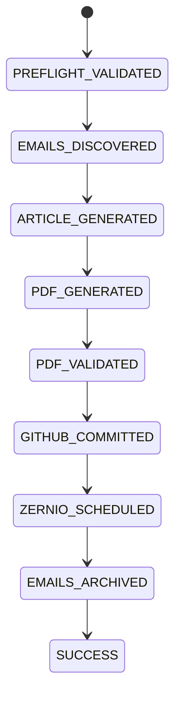

# The Turtle Code automation v2
Business success is independent of scheduler completion. Schedule: 11:00 → 18:00 same day; 20:00 → 08:45 next day, America/Sao_Paulo. Never publish immediately or move existing posts.
## State machine

Persist checkpoints under automation/runs/<slot>.json using current blob SHA for updates. Record UTC timestamps, duration, artifact hashes, commit SHA, post ID, error class and retry count. Keep repository public. Store SHA-256 of Gmail IDs (UTF-8 lowercase hex), public article URLs only, never mailbox URLs, addresses, credentials or email bodies. Hash legacy IDs in memory for deduplication. Historical cleanup is independent and never blocks editorial processing. Keep automation enabled. On retry reconcile external state before writing; use slot and slug as idempotency keys. A checkpoint is evidence, not a claim. On ambiguous Zernio create response, re-list posts before retrying. Never retry an expired slot. No automatic cancellation. SUCCESS only after read-back of artifacts, schedule and Gmail label/archive. FAILED/PARTIAL/SKIPPED otherwise. This is an agent-executed protocol, not an independently deployed service or distributed lock.
